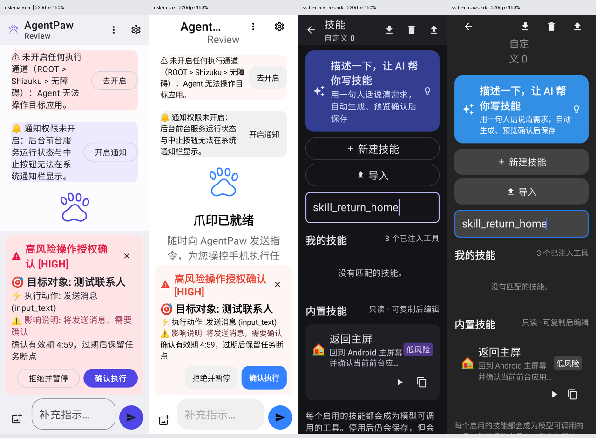

# 代码审查问题处置记录

依据：[CODE_REVIEW_2026-11-09.md](CODE_REVIEW_2026-11-09.md)。保留原始只读审查报告，本文件记录源码核实、实际改动和验证边界。修改位于 `codex/project-maintenance-20261109` 分支，以关联 PR 的提交为准。

## 严重问题

| 编号 | 核实与处置 |
| --- | --- |
| A-01 | 确认存在。滑动、双击、长按、启动、DeepLink 和所有系统按键统一调用实时屏幕守卫；确认令牌不能豁免敏感页。新增 12 种动作调用的矩阵测试，断言没有设备动作发生。 |
| A-02 | 确认存在。敏感页豁免必须同时得到宿主与技能定义授权；导入时关闭该字段并返回警告，许愿生成也不保留该豁免；手动声明在校验器中提示宿主开关要求。测试覆盖两个开关的四种组合。 |
| A-03 | 启动步骤确实遗漏实时检查。已纳入实时屏幕检查、运行期风险评估及目标包名白名单；补充静态启动/按键扫描与变量启动测试。启动普通应用本身属于产品正常能力，没有把所有启动动作一律改为高风险。 |
| A-04 | 确认缺少信任边界提示。网页结果改为明确标记的不可信 JSON 数据，说明不能提供操作指令或用户授权。真实设备动作仍由独立守卫拦截；此改动不等于证明模型免疫提示词注入。 |
| A-05 | 确认会丢失步骤配置。速记携带紧凑的步骤元数据，编辑时仅覆盖显式改变的动作字段；禁用步骤使用可解析前缀，保留 ID、超时、延迟、备注及 options。参数默认值沿用当前定义。新增 14 类动作的步骤往返测试和实际目标编辑测试。另修复滚动动作原先无法解析回原定义的问题。 |
| A-06 | 确认存在语义与数据损失。风险卡片改为“拒绝并暂停”，X 同样拒绝并保留断点，把拒绝记录写入会话。真正放弃任务需确认；没有自动让模型继续操作。新增拒绝不执行、不丢断点的状态测试，以及两套主题下按钮可见、可点击的原生绘制测试。 |

## 中等问题

| 编号 | 核实与处置 |
| --- | --- |
| B-01 | 确认运行标记缺少进度。在工具开始与结束时写入已完成清单、当前步骤及在途动作。支持读取新进度检查点与旧版纯目标标记；旧标记明确注明进度未知。恢复指令要求先核实结果未知的动作，禁止直接重放副作用操作。新增进程恢复测试。 |
| B-02 | 确认失效密钥无法自恢复。仅在明确的永久失效/不可恢复密钥异常时重建密钥，并重试加密一次；其他故障不删除密钥，失败仍拒绝存储明文。新增异常链恢复测试；硬件 Keystore 触发条件未做真机验证。 |
| B-03 | 确认无效或超限图片会拖累会话。非法 Base64、未知图片格式、超限数据不再原样回灌 JSON；保留文字记录。真实磁盘写入故障继续保留有效附件供重试。新增坏图后继续对话、重启恢复文字的测试。 |
| B-04 | 确认孤儿资源问题。删除消息后，持久化最新会话快照并复核图片引用，只删除本会话私有目录内已无引用的文件。测试覆盖共享引用、最后引用删除及同时追加文字，避免清理工作覆盖新内容。 |
| B-05 | 确认阻塞网络不可及时取消。搜索使用异步 Call，与协程取消关联；响应体读取期间也保持可取消，并限制响应大小。重试不吞取消异常。新增本地拦截器停滞请求测试，验证取消及时关闭 Call，不访问公网。 |
| B-06 | 确认请求继承连接失败重试。按配置派生的 LLM 客户端关闭 `retryOnConnectionFailure`，避免隐式重发非幂等生成请求；不能据此保证服务端绝不重复计费。 |
| B-07 | 0 是原本有意的自动模式，问题是缺少绝对边界。现保留自动模式并施加 200 轮上限；显式构造参数 8 不再被当作默认哨兵忽略。保留 Int 构造参数类型，避免引入装箱参数的二进制接口变化。新增显式 8、配置 0、过大配置的执行次数测试。 |
| B-08 | 确认分隔符会造成部分泄露。结构化 JSON 按键递归脱敏；非 JSON 的带引号值完整匹配；损坏 JSON 的敏感字段尾部保守省略。扩展 privateKey、credential 等键名，保留非敏感诊断原文。新增转义引号、空格、逗号、嵌套结构和损坏 JSON 测试。 |
| B-09 | 确认 IPv4-mapped IPv6 兼容性问题。只解析 IPv6 字面量，不为任意主机名做 DNS 查询；区分私网/回环、链路本地、ULA 与公网映射地址。新增网络策略测试。 |
| B-10 | 外部 scheme 的能力面确实需要收敛。保留 http/https/geo 的正常打开流程；其他业务 scheme 要求显式确认；原本禁止的本地文件/组件协议仍直接拒绝。更新自定义 scheme 测试，确认后才能执行。 |
| B-11 | 确认分层约束不足。生成结果仍有 ERROR 时返回 Failure；持久化 save 也拒绝无效定义，不能只依赖 UI。新增仓库拒绝无效定义测试。 |
| B-12 | 确认存在。导入限制 1 MB、200 条、64 层嵌套，并在后台解析；输入框拒绝超大替换并保留原输入。新增三类超限不修改仓库的测试。 |
| B-13 | 重点修复用户实际遇到的配置失败路径。连接错误按超时、网络、鉴权、限流、服务能力分类，显示本地化操作建议；技术详情默认收起且脱敏。保存失败提供明确指引。报告所列聊天复制/日志开关、关于页、通知渠道及静态通知文案已移入中英文资源。核心库仍保留技术诊断文字，未重构全部历史日志及公共错误接口。 |
| B-14 | 确认暂停通知停止路径不一致。运行态仍执行停止；暂停态的通知“停止任务”明确移除断点并结束服务。系统通知交互未做真机验证。 |

## 轻微问题与体验改进

| 编号 | 核实与处置 |
| --- | --- |
| C-01 | 重度清理不便确实存在。历史清理入口增加“删除全部历史”，技能中心增加“删除全部自定义技能”，均需确认；历史清理会停止任务，技能清理保留内置定义。新增待写快照不能复活已删除历史的测试。本轮提供清空全部，未新增任意子集多选交互。 |
| C-02 | 确认“导出”名不副实。改用 Android SAF 创建 JSON 文件，后台写入并报告结果，支持取消和失败提示；不再把复制剪贴板当作文件导出。文件选择器及目标存储提供方仍需设备验收。 |
| C-03 | 确认非 Root 缺少统一进度入口。非 Root 运行/暂停时也显示步骤与当前动作，不再依赖 Root 控制台。 |
| C-04 | 确认授权会无限等待。新增 5 分钟确认有效期及可见倒计时；超时拒绝当前授权并保留任务。点击确认也检查是否过期，防止迟到点击执行旧动作。新增超时不执行且保留断点的测试。 |
| C-05 | 确认入口不易发现。设置首页未解锁时显示说明入口，引导到关于页长按图标；解锁后保留直接入口。 |
| C-06 | 确认模板边界问题。修正包含花括号的兜底值匹配，并用相邻模板测试防止一个模板吞掉后一个模板。没有直接照搬会截断相邻变量的贪婪匹配。 |
| C-07 | 确认错误与 false 不易区分。条件求值返回诊断；运行期表达式错误会写入失败轨迹并停止技能，正常 false 才跳过步骤。 |
| C-08 | 确认注册表同步缺少串行保护。等待初始加载后，在同一仓库互斥锁内更新用户定义、注册差量和 registeredKeys，避免与写操作交错；等待加载放在锁外以免死锁。 |
| C-09 | 确认 lexer 优先级错误。数字读取前识别 `2>`；新增真实解释器测试，检查 stdout 不被转移、命令不多出参数、stderr 文件正确创建。 |
| C-10 | Runner 当前依赖 Main 串行是现有约定。本轮显式标注 MainThread，保留其生命周期/调度设计；资深设置的时钟仅在豁免有效期间继续更新。不把尚未复现的并发竞态表述为已发生的数据错误。 |

## 验证与边界

最终执行：

```powershell
$env:JAVA_HOME = 'C:/Program Files/Java/jdk-21.0.10'
.\gradlew.bat testDebugUnitTest :app:lintDebug :agentpaw-core:lintDebug :app:assembleDebug :app:assembleRelease :app:assembleDebugAndroidTest --offline --no-build-cache --no-configuration-cache --console=plain --max-workers=2
git diff --check
```

- 共 449 项测试：447 通过，2 项既有环境条件测试跳过，0 失败。App 142 项全通过；Core 307 项中 305 通过、2 跳过。在 417 项基线上共增加 32 项测试，其中提交前复查增加 9 项；多个测试包含组合矩阵。
- App/Core Lint：0 错误，分别保留 81/24 项警告；未增加 baseline 或禁用规则。
- Debug、Release、Android 设备测试 APK 均构建成功。曾遇到 Dex 增量缓存引用旧 `D:` 路径，核实构建目录后仅清理本项目的 App/Core 构建输出，禁用构建缓存重建成功。
- 既有确认测试调整为先处理当前事件、再点击确认；超时测试单独推进虚拟时钟。没有跳过新增失败测试。
- 原生绘制与交互回归覆盖 Material/Miuix、320dp 与大字体，确认拒绝入口可见可点击且不会触发放弃回调。窄屏聊天工具栏使用更多菜单，避免动作按钮挤掉标题；续操输入提示压缩为短文案，确认按钮使用正确前景色。



截图使用 Robolectric SDK 34 软件 Canvas，不能代替真机硬件效果。当前没有连接 Android 设备；通知动作、SAF、物理手势、Keystore 失效、Root/Shizuku 和 ROM 行为仍需设备验证。

工具副作用和检查点写盘不是同一事务：极端崩溃窗口不能保证 exactly-once。新增的在途快照和恢复指令用于保留不确定性并要求先核实，不能声称已消除所有重复执行概率。网页数据标记也不能替代模型侧提示词注入评估。

网络取消方案对照了 [Kotlin 官方取消 API](https://kotlinlang.org/api/kotlinx.coroutines/kotlinx-coroutines-core/kotlinx.coroutines/suspend-cancellable-coroutine.html)：取消与回调竞争时不恢复已取消任务，网络 Call 与响应资源在取消时释放。

本轮未合并 PR #70、未向 GitHub 发布评论或审查，也未改写原始审查报告。

## 提交前第二轮复查

新增修复并补充回归：

- **冷启动写入竞态**：所有技能写入、删除、复制与导入先等待初次加载，避免新快照抢先覆盖既有技能文件。
- **部分导入后重复保存**：改为批次校验全部通过后统一落盘；保留的原文修正后重试，不会再次导入前一批已经成功的项。
- **重复技能 key**：仓库拒绝不同用户技能 ID 共用同一 key，防止工具注册时发生静默遮盖。
- **导入体积单位**：后台按 UTF-8 实际字节计算 1 MB 限制，覆盖中文文本的多字节情况。
- **速记守卫编辑**：区分字段缺失与显式填写“否”或空允许列表；总超时支持毫秒且检查数值范围，避免关闭设置不生效或丢失毫秒精度。
- **续操等待期间再次中断**：刚进入续操就保留完整进度检查点，不再先写回纯目标字符串。回归验证在模型尚未返回第一条工具调用时重启仍保留已完成清单。
- **系统时钟回退**：恢复后的确认计时最多为 5 分钟；确认时遇到未来时间戳会拒绝旧授权，避免时钟变化延长授权。
- **历史删除失败**：等待实际删除结果；文件删除失败保留记录和可重试状态，UI 不再提前提示成功。
- **已确认回执恢复**：已标记完成的授权动作只能继续后续任务，不能再次执行，也不再触发授权过期拒绝。续操先持久化替代进度，再删除旧暂停检查点，避免清空窗口。

第二轮复查日志：本地 `build/pr-recheck-final.log`。测试使用与实际检查点写入一致的 `encodeDefaults=true` 序列化种子，保留完整快照相等断言。
