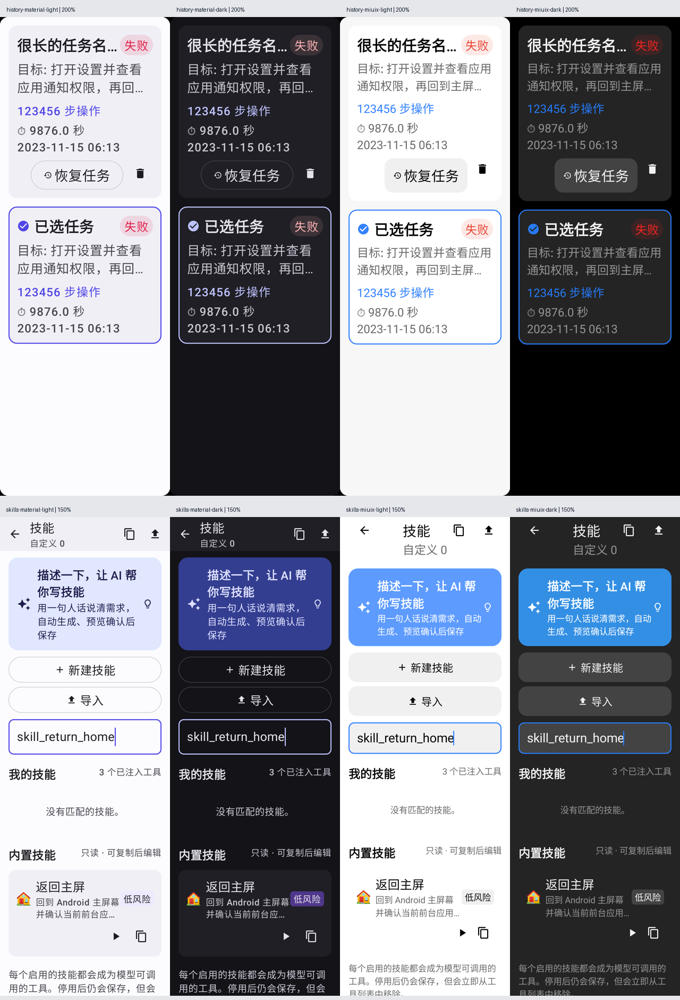

# 项目维护与界面复查

本文件记录第一阶段维护；后续审查修复、最终验证与提交前复查见 [代码审查处置记录](CODE_REVIEW_FIXES_2026-11-09.md)。

基线：`origin/main`（`a92b30d`）；维护分支：`codex/project-maintenance-20261109`。PR #68 已合并，待审 #70 的发现、官方依据及验证边界单列于 [PR 审查记录](PR_70_REVIEW_2026-11-09.md)。

## 已修复

| 问题 | 修复后的行为 | 回归证据 |
| --- | --- | --- |
| 全历史搜索找到的旧记录无法删除 | 删除校验使用完整摘要集合，不再局限于首批 100 条 | 创建 120 条历史，删除未加载页记录，重启后仍不存在 |
| 内置技能的复制按钮只提示成功 | 仓库支持复制真实内置预设，生成独立 ID 和未占用 key；UI 只报告实际操作结果 | 重复复制两次，重读仓库后保留内容和独立标识 |
| 搜索框只过滤自定义技能 | 名称、描述、标签、key 的搜索规则统一覆盖两组技能 | 状态测试及两套主题的实际输入/搜索交互 |
| 导入失败立即清空原文和关闭弹窗 | 导入中禁用重复提交；失败保留文本并显示错误，成功才清空并关闭 | 无效 JSON 失败后重试成功；四套界面组合保留原文和可用按钮 |
| 技能仓库异常未在列表展示，恢复后错误仍残留 | 列表显示存储错误；同步错误状态恢复 | 既有失败保存测试与全量回归 |
| 大字号历史卡片挤掉删除入口 | 标题约束宽度，元信息与操作区自动换行，恢复按钮使用简短文案 | 320dp / 200% 字体下删除按钮可见性断言与截图 |
| 对比模式空结果时无操作入口、返回直接离页 | 空结果也保留对比工具条；提供退出与清除筛选；系统返回先退出选择 | 代码复查；卡片选中语义与点击回归 |
| 选中底色和日期、风险标签对比度不足 | 选中使用主题描边；日期和低风险标签采用可读前景色 | 明暗主题渲染复查 |
| 历史详情/对比初始加载时误报记录不存在 | 等待仓库初始化，区分加载和缺失；恢复失败给出明确反馈 | 代码复查与全量回归 |
| 长弹窗正文挤掉按钮 | 两套主题正文可滚动；Miuix 操作区可换行，保留按钮空间 | 320dp / 200% 字体、长正文下确认按钮可见且可点击 |
| 技能入口按钮、顶栏计数在窄屏大字号下拥挤 | 创建/导入按可用宽度换行，使用简洁计数文案 | 320dp / 150% 字体四套主题截图 |

自适应排版采用 [Android 官方 FlowRow 方案](https://developer.android.com/develop/ui/compose/layouts/flow)，保留现有 Material/Miuix 主题体系。

## 持续维护

- CI 的 Lint 步骤增加 Core 模块检查。
- 每次 CI 保留单元测试报告、App/Core Lint 报告、已有设置页截图以及新增维护截图，方便追查视觉回归。
- 不新增 Lint baseline，不隐藏遗留警告。
- 新增的协议审查记录明确分离静态结论与实测结果。

## 验证

执行：

```powershell
$env:JAVA_HOME = 'C:/Program Files/Java/jdk-21.0.10'
.\gradlew.bat testDebugUnitTest :app:lintDebug :agentpaw-core:lintDebug :app:assembleDebug :app:assembleRelease :app:assembleDebugAndroidTest --offline --console=plain --max-workers=2
git diff --check
```

结果：共 417 项测试，415 通过、2 项既有条件测试跳过、0 失败；其中 App 124 项全部通过，Core 293 项中 291 通过、2 跳过。新增 14 项回归，包含 10 项原生图形/界面交互用例。

App/Core Lint 均为 0 错误，分别保留 78/24 项警告；Debug、Release 和设备测试 APK 构建通过，`git diff --check` 通过。详细日志位于本地 `build/maintenance-verification.log`。测试不使用真实 API Key、不操作手机。本机 `adb devices -l` 无连接设备，未执行本轮设备测试。

截图来自 Robolectric SDK 34 的原生图形环境，使用软件 Canvas 绘制真实组件。历史卡片覆盖 200% 字体，技能中心覆盖 150% 字体，均为 320dp 宽；覆盖 Material/Miuix 明暗主题。软件 Canvas 下 Miuix 使用既有特效降级路径，不能据此声称真机玻璃效果或性能已验收。



验证产物：

- Debug：`app/build/outputs/apk/debug/app-debug.apk`
- Release：`app/build/outputs/apk/release/app-release.apk`
- 设备测试 APK：`app/build/outputs/apk/androidTest/debug/app-debug-androidTest.apk`
- 单张截图：`app/build/reports/maintenance-ui/`

仍需设备验证的范围：ROM/Root/Shizuku 行为、硬件玻璃材质、软键盘实际遮挡、TalkBack 朗读。#70 的 OAuth 与订阅调用另需其专用端到端验证，不能用本维护分支的通过结果代替。
