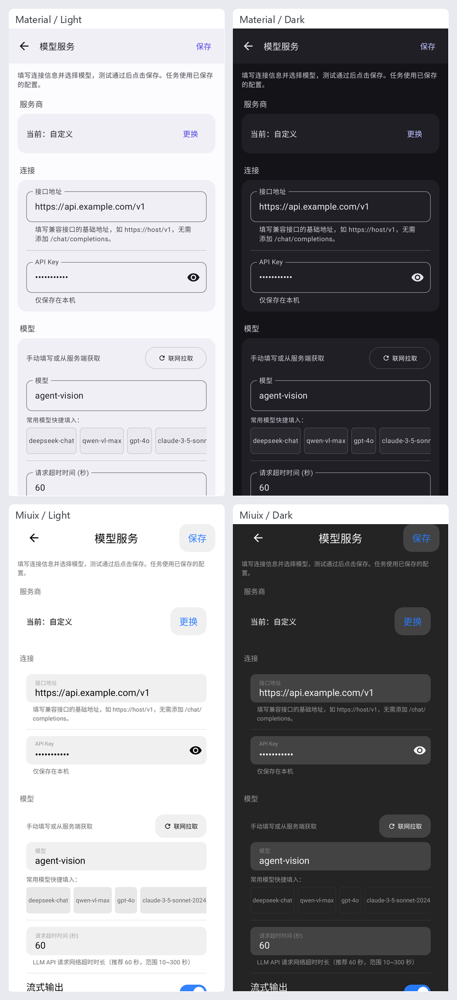

# 提交前功能与界面复查

基线：`release/0.4.0`。本次 PR 汇总模型服务设置、手绘爪印、输入重复粘贴、新建技能 ICU 崩溃及以下复查修复。

## 新发现与修复

- **技能草稿丢失**：存在校验错误时切换速记 / JSON 模式会覆盖原始输入。现在保留原文并提示先修正错误；JSON 无法解析时禁用结构化修改。
- **返回保护与保存**：有修改时返回需要确认；保存期间禁用编辑及重复保存；保存后退出不再自动创建新草稿。新技能使用未占用的默认 key，并显示“新建技能”标题。
- **设置页首屏**：已有配置时收起服务商网格，通过“更换”展开；缩短操作说明，去除重复标题，统一自定义服务商的中文名称。
- **草稿与生效配置**：设置首页显示已保存的服务商，同时提示未保存的草稿，避免混淆实际任务使用的配置。
- **输入清空**：修正系统不支持的 `input keyevent --meta` 参数，使用 `input keycombination` 组合键；包含 `%` 的文本使用直接设置或一次粘贴，避免 shell 输入转码破坏内容。
- **软件绘制崩溃**：Miuix 玻璃叠层仅在支持的硬件画布上使用 RuntimeShader，软件绘制保留基础 UI 并跳过特效。
- **边界显示**：非法执行步数不再显示成“不限”，较长的步数信息限制宽度并允许换行；拉取模型结果的数量与过滤后的实际列表一致。

## 界面验证

原生绘制测试覆盖 Material / Miuix 明暗主题、生成参数页面、320dp 窄屏及 1.5 倍字体。已人工检查输出的 8 张页面图，确认主要控件可见、文本不重叠、表单与操作区保持清晰层级。

截图来自 Robolectric 原生图形环境中的软件 Canvas。Miuix 使用本次修复的特效降级路径，因此截图用于检查颜色、文字和布局，不能代替真机硬件玻璃效果验收。

## 验证结果

- 共 399 项单元及本地界面测试：397 项通过、2 项既有测试跳过、0 失败。
- Debug、Release、Android 测试 APK 均构建成功。
- App Lint：0 错误、82 警告；Core Lint：0 错误、24 警告。警告主要为既有资源清理、依赖更新及文案建议。
- `git diff --check` 通过。
- CI 的 PR 触发范围加入 `release/**`，设备测试覆盖 API 26、35、36。

本机没有连接 Android 设备，设备测试仅完成编译，实际执行交由 PR CI；一加 Ace 6 的设备专有行为仍需真机验收。ICU 正则修复另已完成原生 ICU 前后对照，详见 `SKILL_CREATION_FIX_2026-10-29.md`。
